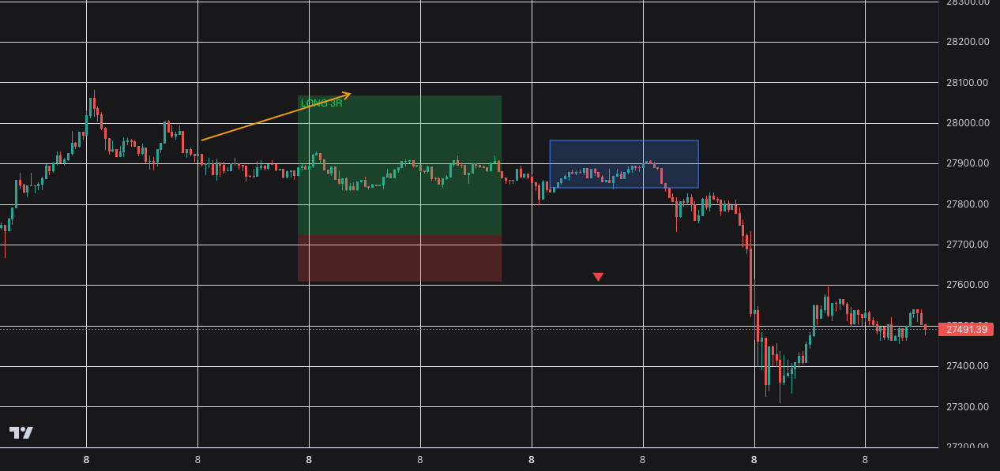

# Naga chart primitives

The Naga chart is an opt-in lightweight-charts view of the same candles, with
four drawing primitives on top. It is off by default and lives next to the
upstream chart, so turning it on never removes the old one.

## Enable

Open `/graph` or the trade view and tick **Naga chart** in the chart toolbar.
The choice is stored in `localStorage` as `nagaChartEnabled` and starts `false`,
so a fresh browser sees the upstream `CandleChart` until you tick the box.

## Tools and clicks

Pick a tool in the chart toolbar, then click the chart. The chart has to know
where the primitive starts and ends, so each tool asks for a fixed number of
clicks:

| Tool | Clicks | What each click places |
|---|---|---|
| `RR Long` | 2 | entry, then the stop distance |
| `RR Short` | 2 | entry, then the stop distance |
| `Block` | 2 | opposite corners of the zone |
| `Arrow` | 2 | tail, then head |
| `Entry Long` | 1 | the marker position |
| `Entry Short` | 1 | the marker position |

A risk/reward primitive uses the `k` input in the toolbar, default `3`, as its
reward-to-risk ratio. The second click sets the risk side; the reward side is
derived from `k`. Lightweight-charts swallows a second click that lands inside
its 500 ms double-click window, so wait a moment between the two clicks of a
primitive.

## Toggle

Four independent checkboxes control what renders: **Show RR**, **Show Block**,
**Show Arrow** and **Show Entry**. They are stored together as
`nagaPrimitiveVisibility` in `localStorage`. Hiding a primitive never deletes
it, so ticking the box again brings the drawing back unchanged.

## Colors

Risk is red and reward is green on both long and short primitives, so the pair
always reads the same way regardless of direction. The order label is green for
`LONG` and red for `SHORT`, and entry markers follow the same rule: a green
marker for a long entry, a red one for a short entry.

## Persistence

Drawings are saved per market and timeframe under the `localStorage` key
`nagaDrawings:<pair>:<timeframe>` - for example
`nagaDrawings:BTC/USDT:1m`. Switching pair or timeframe loads that pair's own
set of drawings. **Clear drawings** empties the key for the current pair and
timeframe only; other markets keep their drawings.

## Limits

This chart has no indicators, no subplots, no trade overlays and no Heikin Ashi
yet. It draws candles and the four primitives above, nothing more. The chart
controls (interval, style, the upstream toolbar) are G5's job and are not part
of this view.

## Evidence

